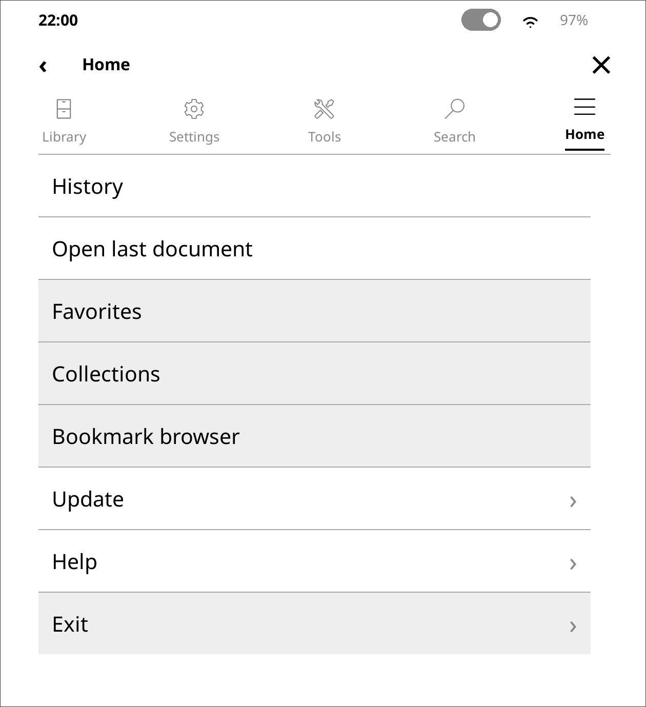
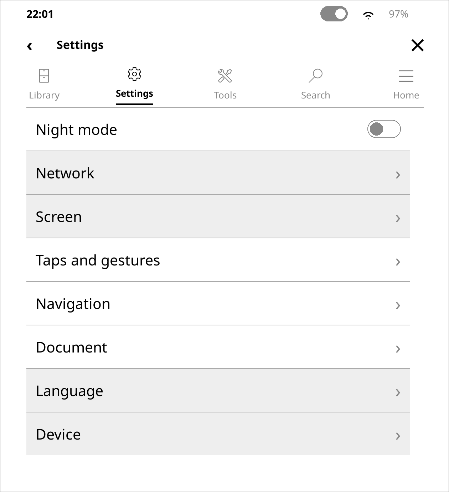
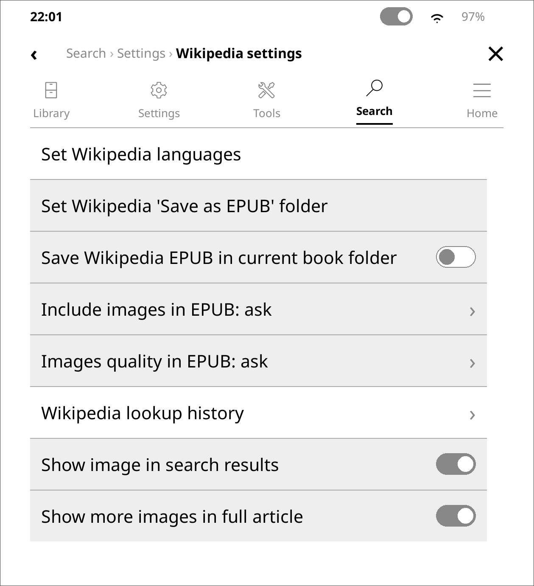
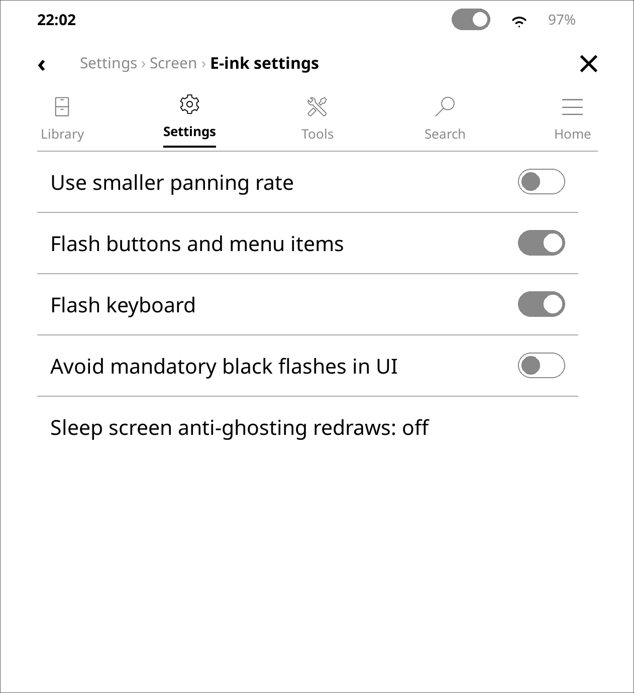
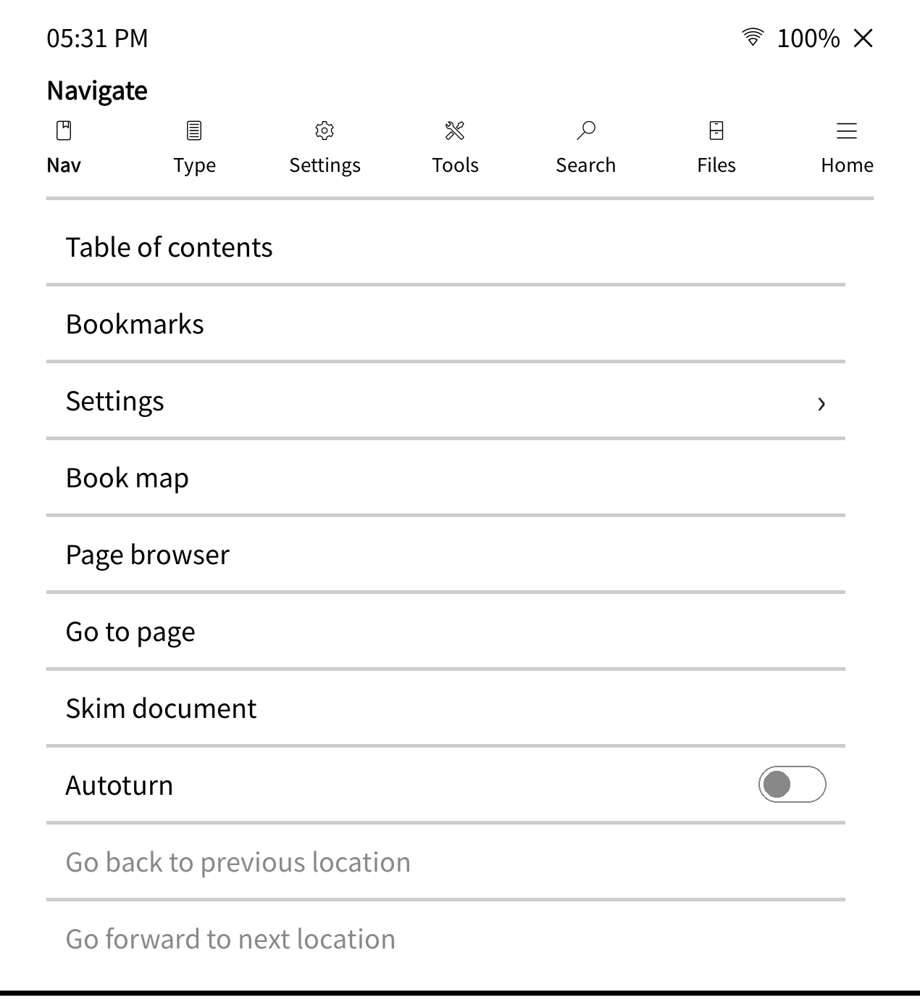

# modern_menu

A **Kobo-inspired** replacement for KOReader’s stock top menu, built to complement [Kobold](https://github.com/unitreign/kobold). Same actions and submenus you already know — clearer layout, larger touch targets, and an e-ink friendly look that sits beside Kobold’s home screen.


|                   |                                                                             |
| ----------------- | --------------------------------------------------------------------------- |
| **Plugin folder** | `modern_menu.koplugin`                                                      |
| **Requires**      | [KOReader](https://github.com/koreader/koreader) (recent stable or nightly) |
| **Platforms**     | E-ink devices and desktop (SDL) builds                                      |


## Screenshots

<p align="center">
  
  
  
</p>

<p align="center">
  
  
</p>


---

## Why this exists

KOReader’s stock `TouchMenu` is powerful but dense: small rows, nested chrome, and a look that feels more “utility panel” than a modern e-reader shell.

**modern_menu** keeps the *live* KOReader menu tree (callbacks, checks, holds, plugins — nothing hardcoded) and presents it with:

- Touch-first rows and clear hierarchy  
- High-contrast monochrome styling suited to e-ink  
- Optional Kobo-like status chrome in the menu (and file browser)

If you want Nickel-like clarity without giving up KOReader’s depth, this plugin is for you. With Kobold installed, Modern Menu is the menu for that home screen: it opens from Kobold’s pages, and a Kobold tab takes you home.

---

## Features

### Full menu replacement

- Hooks `ui.menu.onShowMenu` so swipe-down / Menu key opens Modern Menu instead of stock TouchMenu  
- Renders the real `tab_item_table` — every stock and plugin entry still works  
- Breadcrumbs for nested menus. Back (`‹`) sits with the title inside a submenu; close sits with the status icons  
- Tab bar with KOReader `appbar.`* icons. Each icon is centered on its label, the selected tab is bold, and a light rule sits under the row  
- Light-gray separators between items  
- Gray toggle switches and vertical scrollbar (no fake horizontal scroll)

### Status bar (menu + optional file browser)

Shown at the top of the modern menu:


| Control        | Action                                                               |
| -------------- | -------------------------------------------------------------------- |
| **Time**       | Current time, 12-hour                                                |
| **Contrast**   | Frontlight panel (devices with a light only)                        |
| **Wi‑Fi**      | Open KOReader network / Wi‑Fi UI                                     |
| **Battery**    | Battery icon; opens **Battery statistics** (batterystat plugin)     |


The same bar can sit above the file browser. That is off until **Modern Menu → Status bar in file browser** is enabled.


The status bar is **never** injected into the reader view — use KOReader’s own header/footer settings while reading.

### Escape hatch

Dispatcher actions (also usable from gestures / profiles):

- **Modern menu** — open the menu  
- **Toggle stock KOReader menu** — flip between Modern Menu and stock TouchMenu (persisted)

---

## Installation

Copy the `modern_menu.koplugin` folder into your KOReader plugins directory, then restart KOReader (or reload plugins) and enable **Modern Menu** under **Tools → More tools → Plugin management**.

Typical plugins paths:


| Install type        | Path                                             |
| ------------------- | ------------------------------------------------ |
| **E-ink device**    | `koreader/plugins/` next to the KOReader install |
| **Linux / desktop** | `~/.config/koreader/plugins/`                    |
| **Android**         | Under KOReader’s data dir → `plugins/`           |


The folder name must end with `.koplugin`.

### Uninstall

Remove or disable `modern_menu.koplugin`, then restart KOReader. To go back temporarily without uninstalling, use **Toggle stock KOReader menu**.

---

## Usage tips

- **Swipe down** from the top edge still opens the menu; Modern Menu consumes that gesture so stock TouchMenu does not also appear.  
- **Tap** a row for the usual action; **long-press** where stock supported it (help text, style-tweak details, book-specific CSS editor, etc.).   
- **Modern Menu → Status bar in file browser** shows the same status bar above the file list. It is off until you turn it on. The menu always keeps its own bar.

---

- No smooth animations or continuous scroll physics  
- No translucent overlays or drop shadows  
- Solid borders / high-contrast text  
- Screen refreshes (`setDirty`) only on real state changes

The status bar uses KOReader’s own icons (contrast, Wi‑Fi, and a drawn battery). Spare [Lucide](https://lucide.dev/) SVGs remain under `icons/` (ISC); see `[modern_menu.koplugin/icons/NOTICE](modern_menu.koplugin/icons/NOTICE)`.

---

## Repository layout

```text
modern_menu.koplugin/     ← install this folder
  _meta.lua               Plugin name & description
  main.lua                Hook + file-browser status chrome
  ui/                     Menu shell, tab bar
  widgets/                Rows, toggles, status bar, breadcrumbs
  icons/                  Lucide SVGs + NOTICE
```

---

## Compatibility & limitations

Works with these plugins:

- [Kobold](https://github.com/unitreign/kobold) — this menu is meant to live beside it. The pull-down opens on Kobold’s screens, and a Kobold tab opens Kobold Home
- [Simple UI](https://github.com/doctorhetfield-cmd/simpleui.koplugin) — its quick-settings tab is hosted here, including taps, swipes, and holds on that panel
- [Quick Menu](https://github.com/jbreizh/quickmenu.koplugin) — hosted as a tab. It stays first, and the menu opens on it while “Always start on quick menu tab” is on (the default). Hold that tab to open Quick Menu settings
- Neo Quick Settings (`neo_quicksetting.koplugin`, a Quick Menu fork) — hosted the same way. Its action buttons are plain frames, so this shell hit-tests them. The menu opens on that tab while “Show as default tab when menu opens” is on
- [Shortcuts Toolbar](https://github.com/xusoo/shortcutstoolbar.koplugin) — when enabled, its reader shortcut row (back button and icons) is pinned to the bottom of this menu, and the file-browser shortcut row is pinned there too. Custom shortcuts run from that row, including system actions and menu-path actions, and you can record a menu action from this menu. The file-browser shortcut row also appears above the file list when KOReader opens there. It shares that space with this menu’s file-browser status bar only when **Status bar in file browser** is on

It does not work with Zen OS. Zen OS replaces the same menu surface.

- Targets current KOReader Lua plugin APIs (`UIManager`, `TouchMenu`-compatible `closeMenu` / `updateItems`).  
- If a future KOReader release changes menu internals, update the plugin or use the stock-menu toggle.  
- Frontlight control appears only when `Device:hasFrontlight()` is true.  
- Battery statistics requires the stock **batterystat** plugin (ships with KOReader).

---

## Contributing

Issues and pull requests are welcome. Please keep e-ink constraints in mind (no animation-heavy UI, prefer solid contrast, avoid patching KOReader core — this plugin injects via `UIManager` only).

---

## Credits

Thanks to [reign](https://github.com/unitreign) for [Kobold](https://github.com/unitreign/kobold). Modern Menu takes its type, spacing, and home-screen manners from that plugin, and is meant to be used with it.

- [KOReader](https://github.com/koreader/koreader) — host application and menu data  
- [Kobold](https://github.com/unitreign/kobold) by [reign](https://github.com/unitreign) — the home screen this menu complements  
- [Lucide](https://lucide.dev/) — SVGs under `icons/` (ISC License)  
- Inspired by the clarity of Kobo’s Nickel UI (no proprietary Kobo assets are included)

---

## License

Plugin code: see the repository license file (add one before publishing if you have not already).  
Icons under `modern_menu.koplugin/icons/`: **ISC** (Lucide); attribution in `icons/NOTICE`.